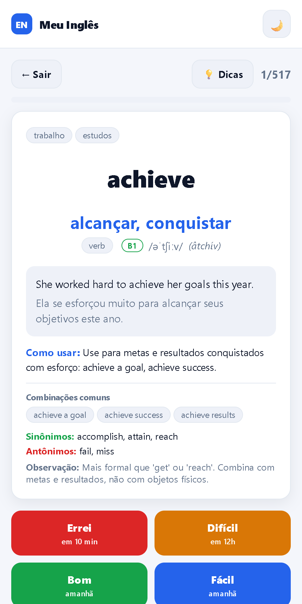

# Meu Inglês, a spaced-repetition vocabulary app

An offline-first PWA I built to stop forgetting the English words I learn. It uses the same idea as Anki: a spaced-repetition scheduler (SM-2) decides when each word comes back, so the ones I miss return soon and the ones I know return further and further apart. No backend, no login, no tracking, every card lives on the device.

**Live app:** https://meu-ingles-srs.vercel.app

<p align="center">
  
</p>

## Why I built it

I am learning English and I kept losing new vocabulary within days. I did not want another flashcard product with an account and a subscription, I wanted one mechanic done well and something I would actually open every morning. So I built it, shipped it, and I use it daily. It is a small product, and that is the point: one proven learning mechanic, shipped end to end and maintained.

## What it does

- Add words with translation, and optionally an example sentence, IPA, usage note and tags.
- Review: the app shows the English word, you try to recall it, reveal the answer and rate yourself (Again, Hard, Good, Easy).
- The scheduler sets the next review from that rating. Due cards come first, lightly shuffled so you do not memorize the order.
- Bulk import by pasting one word per line, export and import a JSON backup, dark and light themes, installable on the phone home screen, fully offline.

## How the spaced-repetition engine works (SM-2)

Each card stores an ease factor, an interval, a streak of correct answers and a due date. The rating drives the schedule:

- **Again** resets the streak, lowers the ease factor and brings the card back in 10 minutes.
- **Good** applies the standard SM-2 curve: 1 day, then 6 days, then the previous interval times the ease factor.
- **Hard** and **Easy** nudge the interval and the ease factor down or up.

The ease factor starts at 2.5 and never drops below 1.3. The whole algorithm is a small, pure, unit-testable module in [`src/sm2.ts`](src/sm2.ts), separated from the UI and the database on purpose.

## Engineering notes

- **Offline-first PWA.** Service worker and manifest via `vite-plugin-pwa`; installs to the home screen and runs with no network.
- **Local-only data.** IndexedDB through Dexie.js. Nothing leaves the device, so there is no privacy surface and no server to run.
- **Separation of concerns.** Domain logic (`sm2.ts`, `fila.ts`) is decoupled from storage (`db.ts`) and from the screens, which keeps the scheduler testable in isolation.

## Tech stack

React, TypeScript, Vite, Dexie.js (IndexedDB), `vite-plugin-pwa`.

## Run locally

```bash
npm install
npm run dev     # http://localhost:5173
npm run build   # production build in dist/
```

## Note

The interface is in Portuguese because I built this for my own daily use. The code, structure and this README are in English. A detailed Portuguese guide is in [README.pt.md](README.pt.md).

## License

MIT, see [LICENSE](LICENSE).
